# kudio architecture

This document explains how kudio works internally: its threads and how they
communicate, the signal path, how loops are recorded and kept in time, how
parameters flow, how sessions are stored, and the rules that keep the audio
thread glitch-free.

Contents

1. [Design goals](#1-design-goals)
2. [Source map](#2-source-map)
3. [Threads and queues](#3-threads-and-queues)
4. [The audio engine](#4-the-audio-engine)
5. [Signal flow](#5-signal-flow)
6. [Recording a loop](#6-recording-a-loop)
7. [Loop timing math](#7-loop-timing-math)
8. [Tracks](#8-tracks)
9. [The parameter system](#9-the-parameter-system)
10. [Input: keyboard and MIDI](#10-input-keyboard-and-midi)
11. [Sessions, presets, takes](#11-sessions-presets-takes)
12. [Real-time safety rules](#12-real-time-safety-rules)
13. [Startup and shutdown](#13-startup-and-shutdown)
14. [Testing](#14-testing)
15. [Developer log](#15-developer-log)

---

## 1. Design goals

| Goal | How |
| --- | --- |
| **Lightweight** | 7 small dependencies, no GUI, no async runtime. The release binary is about 1.1 MB (LTO + strip). Idle CPU use is the audio callback plus an 8 ms UI poll. |
| **Low latency** | 256-frame buffer by default (≈5.3 ms at 48 kHz). The keyboard goes straight to a lock-free queue, and MIDI goes to its own queue without touching the UI thread. |
| **Glitch-free** | The audio thread never locks, allocates, frees, or does I/O ([§12](#12-real-time-safety-rules)). |
| **Everything editable later** | Synth loops store *notes*, not audio, and are re-synthesized every pass. Every track has its own full parameter set. |
| **Loops stay in sync** | One sample-accurate clock, and every track's playhead is derived from it ([§7](#7-loop-timing-math)). |
| **Transparent** | Every action is logged. Sessions are plain JSON + WAV. |

---

## 2. Source map

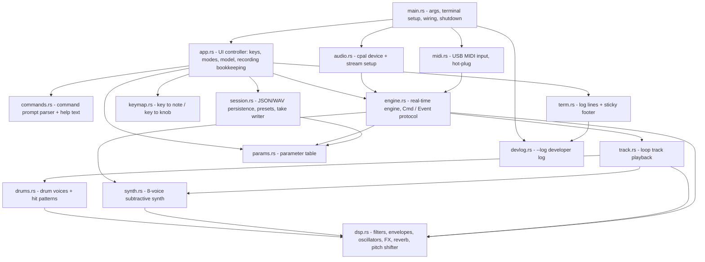

| File | Lines of responsibility |
| --- | --- |
| `params.rs` | One flat table (`SPECS`) of 44 parameters: name, range, default, step, display format, and scope flags. Parsing (`2k`, `50%`, `20ms`, `saw`, `1/8`, `2x`, `on`) and formatting. Pages for control mode. |
| `dsp.rs` | `Smooth` (one-pole de-zipper), `Svf` (Cytomic/Simper state-variable filter), `Adsr`, PolyBLEP oscillators, `Delay`, `PitchShifter` (two-tap crossfading delay line), `Reverb` (Freeverb), `Fx` (per-source chain), `soft_clip`. |
| `synth.rs` | 8-voice polysynth with voice stealing, glide, sustain pedal, bend, and mod wheel. Modulation is evaluated every 16 samples. |
| `track.rs` | `Track`: a synth event sequence, mono audio, *or* a drum pattern, plus its own `Fx` and params. Sample-accurate event/hit playback and phase-locked seeking. |
| `drums.rs` | `DrumVoice` (kick, snare, hihat, cymbal synthesized from oscillators, noise and envelopes) and `Pattern` (where hits fall in a loop). |
| `engine.rs` | The `Engine` owned by the audio callback. `Cmd` (in) / `Event` (out) protocol, mixing, recording state machine, metering. |
| `audio.rs` | Picks devices and a sample rate (48 kHz preferred), builds the output and optional mic streams, and moves the engine into the output callback. |
| `midi.rs` | Parses MIDI bytes into `Cmd`s. Scans for devices every 2 s and reconnects after unplugging. |
| `app.rs` | The UI thread's state: mode, module, selection, the *model* (all params + track list), loop length and tempo, recording bookkeeping, drum tracks, the delete confirmation, footer. |
| `commands.rs` | The `Enter` prompt: `set`, `tracks`, `mute`, `preset`, `bpm`, `drums`, … |
| `session.rs` | Save/load of sessions and presets, track WAVs, the background take writer. |
| `term.rs` | Timestamped, colored log lines that scroll above a redrawn footer. Every line is mirrored to the developer log. |
| `keymap.rs` | Tracker-style piano layout and the control-mode knob layout. |
| `devlog.rs` | `--log`: a global line-buffered file and the `dlog!` macro ([§15](#15-developer-log)). |

---

## 3. Threads and queues

kudio runs five kinds of threads. They share **no locks on the audio path**:
all communication goes through single-producer/single-consumer lock-free
ring buffers (`rtrb`) or, between non-real-time threads, `std::sync::mpsc`.

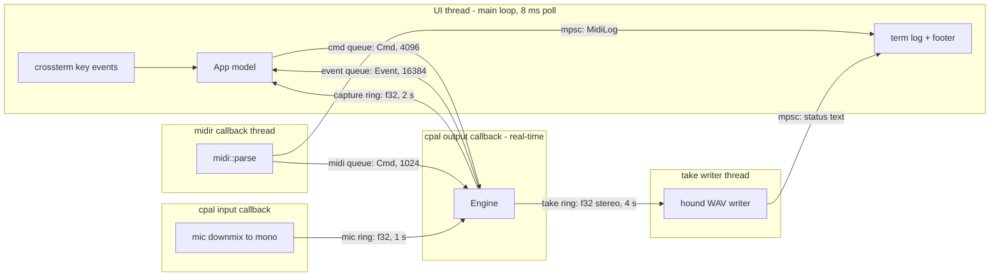

| Queue | Producer → consumer | Carries | If full |
| --- | --- | --- | --- |
| `cmd` | UI → engine | note on/off, params, arm/stop, add/remove track, … | UI logs a warning; the command is dropped |
| `midi_cmd` | MIDI → engine | note on/off, sustain, bend, mod wheel, panic | event dropped |
| `mic` | input callback → engine | mono mic samples | newest samples dropped |
| `events` | engine → UI | recording events, track started, garbage, meters, overflow warnings | dropped (see §12) |
| `capture` | engine → UI | mono voice audio while recording a voice loop | engine reports `Overflow` once |
| `take` | engine → take thread | interleaved stereo master output | engine reports `Overflow` once |

MIDI has its **own** queue straight into the engine. That way a busy UI
thread (redrawing, saving a session) can never delay a note from the piano,
and the two producers never contend. The MIDI producer is held in an
`Arc<Mutex<…>>` that only the MIDI thread locks, so it can be reused across
reconnects. The audio thread never touches that mutex.

---

## 4. The audio engine

`Engine` (`engine.rs`) is created on the main thread. `audio.rs` places it in
an `Arc<Mutex<Option<Engine>>>` slot, and the output callback `take()`s it on
its first call (with `try_lock`, which can't block). From then on the engine
is owned exclusively by the audio thread.

Each callback:

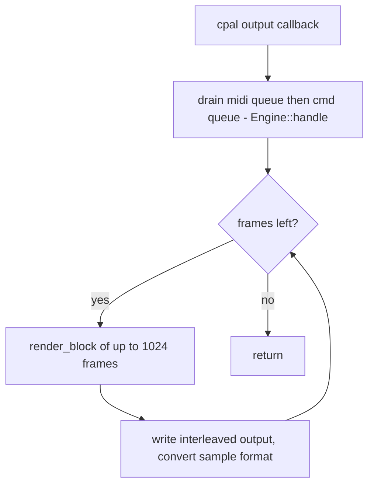

`render_block(n)`:

1. Clear the stereo mix `l`, `r` and the reverb bus `rev`.
2. **Live synth**: `synth.render` → `synth_fx.process` adds into `l`/`r`/`rev`.
3. **Live voice**: pull `n` mic samples (resyncing if the backlog exceeds
   30 ms) → `ingain` → pitch shift (`pitch` + held-key offset). If a voice
   loop is recording, copy the samples into the capture ring. If monitoring
   is on, `voice_fx.process` adds into the mix.
4. **Tracks**: for each track, `render` the dry signal, then
   `fx.process(audible = !muted && (no solo || solo))`. Muted tracks keep
   running, so un-muting is seamless and echo tails decay naturally.
5. **Master**: add the Freeverb return, apply smoothed master volume, then
   `soft_clip`.
6. **Take**: if recording the session, push the interleaved stereo block.
7. Advance `clock += n`, and send a `Meter` event about 15 times a second.

`clock` is a `u64` frame counter. It's the only notion of time in the
engine; loop positions, recording start/end and meters are all expressed in
frames of `clock`.

---

## 5. Signal flow

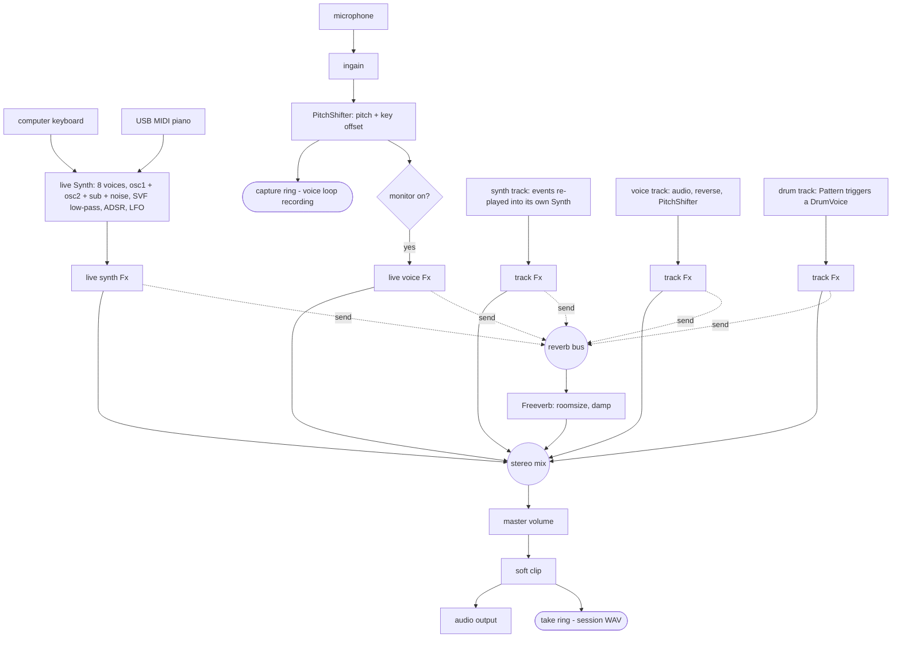

**Per-source FX chain** (`dsp::Fx`). Every live source and every track has one:

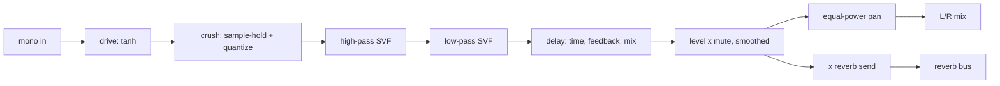

Stages at their neutral value are skipped (`drive`/`crush` = 0, `hp` = 20 Hz,
`lp` = 20 kHz), so an untouched chain costs almost nothing. Coefficients are
recomputed once per block in `Fx::prepare`. Level and pan are smoothed per
sample, so knob turns and mutes don't click.

**Synth voice:**

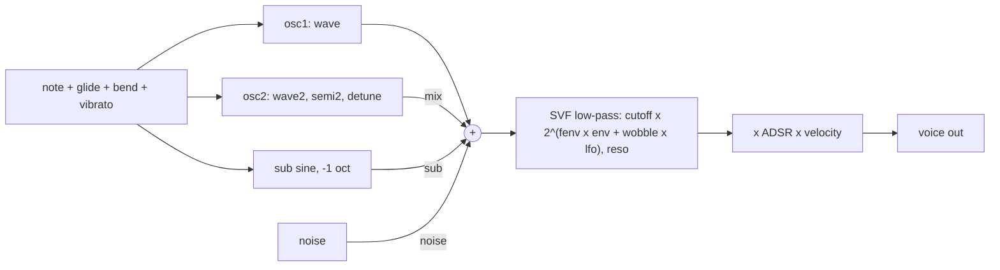

Oscillators use PolyBLEP to reduce aliasing. Pitch, the filter cutoff and
the LFO are recomputed every 16 samples (`CONTROL_RATE`) to save CPU. When
all 8 voices are busy, the oldest is stolen. The sustain pedal defers
note-offs until it is released.

---

## 6. Recording a loop

Recording is split between the two threads. The **engine** decides *when*
recording starts and stops, to the exact sample. The **UI** collects the
material and builds the track.

### Engine state machine

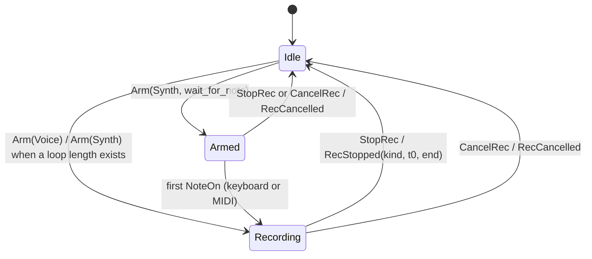

- **Armed** exists only for the *first* synth loop (`loop_len` is `None`).
  It makes the loop start exactly on the first note, so the loop length is
  exactly what the musician played. Once a loop length exists, later loops
  start the moment Space is pressed, and their phase comes from `t0` (§7).
- On entering **Recording** the engine sends `RecStarted { kind, t0 = clock }`.
- While a **synth** loop records, every NoteOn/NoteOff/Sustain handled by the
  engine is sent as `RecEvent(SeqEvent { at: clock - t0, ev })`. That
  timestamp is the *block-start* clock at which the command was dequeued,
  which is the moment the note was actually heard. Keyboard and MIDI are
  treated alike.
- While a **voice** loop records, the post-pitch-shift, pre-FX mic signal is
  written to the capture ring.

### End to end

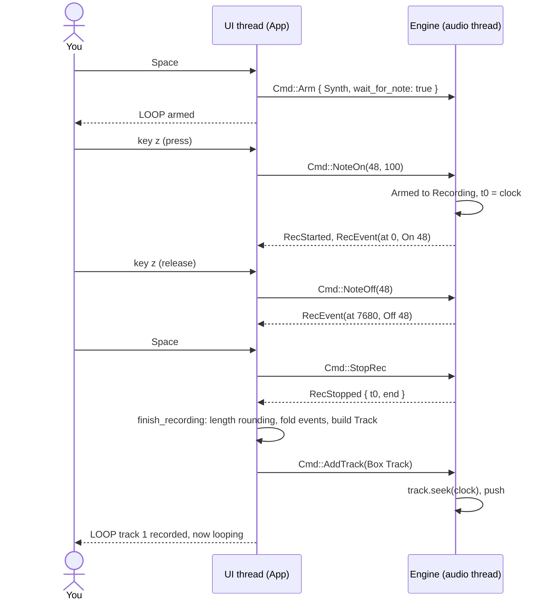

`App::finish_recording(kind, t0, end)`:

1. `frames = end - t0`. Recordings under 0.1 s, or synth recordings without
   notes, are discarded.
2. Choose the track length `len` (§7.2).
3. Fold the material into `len`: `fold_events` for synth, `fold_audio` for
   voice (§7.3).
4. Copy the current live parameters into the track. For voice the `pitch` is
   reset to 0, because the shift is already baked into the audio.
5. If this is the first loop, set `loop_len = len` and `loop_t0 = t0`.
6. Build the `Track` on the UI thread and send it with `Cmd::AddTrack`.

---

## 7. Loop timing math

All positions are in frames of the engine `clock`.

### 7.1 Phase-locked playback

A track has a length `len` and a recording start `t0`. Its playhead at any
absolute time `clock` is:

```text
pos = (clock − t0) mod len
    = (clock + len − (t0 mod len)) mod len      ← the form used in Track::seek (no underflow in u64)
```

Each block, `pos` advances by one per frame and wraps at `len`. When a track
is added, `seek(clock)` sets `pos` and binary-searches the event cursor
(`partition_point(at < pos)`).

So a sound recorded at absolute time `T` sits at index `(T − t0) mod len`,
and plays back whenever `clock ≡ T (mod len)`. **Every loop replays exactly
where it was performed**, regardless of when recording started. Recording
can start mid-cycle, and loaded sessions resume with the same relative
phases.

### 7.2 Length rounding

```text
first loop:   len = frames                            → loop_len := len
later loops:  n   = max(1, round(frames / loop_len))
              len = n × loop_len
```

Because every `len` is a multiple of `loop_len`, all tracks realign every
`lcm` of their lengths (for 1×/2×/4× loops, that's every 4 cycles).
`loop <seconds>` can set `loop_len` up front, before any track exists.

Example (48 kHz): the first loop is 3.75 s, so `loop_len` = 180 000. A later
recording lasting 7.9 s gives n = round(2.107) = 2, so len = 360 000 (7.5 s).

### 7.3 Folding

The recording usually doesn't match `len` exactly, so it is wrapped onto it:

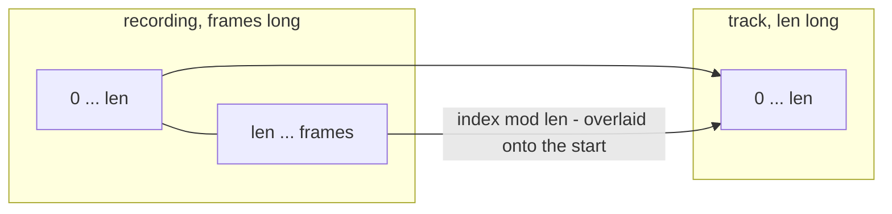

- **Synth (`fold_events`)**: notes still held at the end get a NoteOff at
  `frames − 1` (as does a sustain pedal still down). Every event's `at`
  becomes `at mod len`. Events are then sorted by `SeqEvent::order_key`,
  i.e. `(at, rank)` with Off < Sustain-up < Sustain-down < On, so that at
  the same instant a note is released before it is re-triggered (no stuck
  notes on the wrap). Session loading uses the same ordering.
- **Voice (`fold_audio`)**: 5 ms linear fades at both ends of the recording
  (no clicks), then each sample is added to `out[i mod len]`. If the
  recording is shorter than `len`, the rest stays silent.

Because folding uses `mod len` relative to `t0`, and §7.1 plays index
`(clock − t0) mod len`, folding preserves the timing: a note played 0.2 s
late in the next cycle plays at 0.2 s into the loop.

---

## 8. Tracks

```rust
pub struct Track {
    id, len, t0, pos, muted, solo,
    params: Params,          // full parameter array (synth or voice scope)
    fx: Fx,
    source: Source,
}
enum Source {
    Synth { synth: Synth, events: Arc<[SeqEvent]>, cursor: usize },
    Voice { audio: Arc<[f32]>, shifter: PitchShifter },
    Drum  { voice: DrumVoice, bars: u32 },
}
```

- **Synth track**: owns a private `Synth` and replays its event list. In
  `render` it splits the block at each event's exact frame, so playback is
  sample-accurate. At the end of the loop the cursor rewinds to the first
  event. A note held across the loop boundary keeps ringing into the next
  pass: folding turned it into an On near the end and an Off near the start.
  Notes still held when recording stopped were given an Off, so nothing
  hangs forever. Because the notes are re-synthesized, any synth parameter
  can be changed afterwards.
- **Voice track**: reads `audio[pos]`, or `audio[len − 1 − pos]` when
  `reverse` is on, and runs it through its own `PitchShifter`. The shifter
  bypasses itself (bit-exact) at 0 semitones and crossfades into and out of
  the shifted signal.
- **Drum track**: stores no data. Hits are computed from `len`, `bars` and
  the `rate`/`offset` params ([§8.1](#81-drum-tracks)), and each hit
  retriggers the track's own `DrumVoice`.
- Track data is held in `Arc<[…]>`. The UI keeps a `TrackModel` sharing the
  same `Arc`, so the engine and the UI share one copy of the audio and saving
  needs no round trip through the audio thread.
- Each track's state (`Fx` delay line, synth voices) is built on the UI
  thread and moved into the engine inside a `Box` (`Cmd::AddTrack`).
- Limit: 64 tracks (`MAX_TRACKS`). `Vec<Box<Track>>` is pre-allocated with
  that capacity, so pushing never reallocates on the audio thread.

**Track numbers vs. ids.** Users refer to tracks by their *position* (1, 2,
3, …) in the list. Internally each track has a stable `id` that never gets
reused within a session. It names the WAV file and is what `Cmd`s refer to,
so deleting track 2 doesn't make a pending command hit the wrong track.

**Deleting from control mode.** `Delete` on a selected track only *arms* the
delete: `App::pending_delete = Some(id)`, and the footer shows a warning
line. A second `Delete` calls `App::remove_track(id)`, which sends
`Cmd::RemoveTrack` (the engine hands the track back as garbage). Any other
key press clears the pending delete. `Esc` is consumed by the cancel, so it
doesn't also fire the panic. Holding the id rather than the position means a
confirm can never hit a different track.

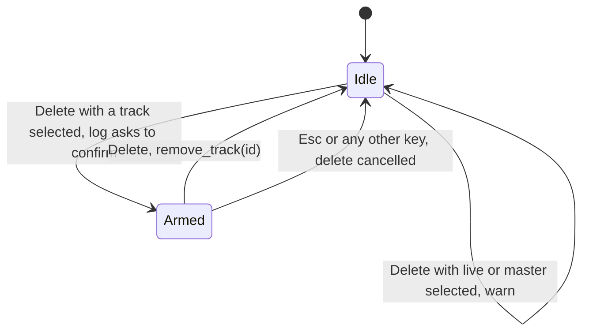

### 8.1 Drum tracks

The drums module has no live sound source in the engine. Pressing a drum key
creates a **drum track** straight away, so there is nothing to record.
`Target::LiveDrums` (`App::live_drums`) only holds the *template* that new
drum tracks copy (`tune`, `ddecay`, `tone`, `punch`, FX). The engine ignores
`SetParam` for it.

**Tempo and loop length.** `App::bpm` (default 120, saved in the session)
is free to change only while `loop_len` is `None`. A bar is 4 beats:

```text
bar(bpm) = 240 × sample_rate / bpm             frames

no loop yet:      loop_len := round(bar(bpm)),  bars = 1
loop exists (L):  bars = max(1, round(L / bar(bpm)))
                  bpm  := 240 × sample_rate × bars / L     (fitted, logged, then locked)
drum track:       len = loop_len,  bars as above
```

**Hit positions** (`drums::Pattern`, recomputed every block so `rate` and
`offset` changes apply immediately):

```text
bar      = len / bars                    (f64)
interval = bar / divs[rate]              divs = 1, 2, 4, 8, 16 for 1/1 … 1/16
first    = (offset × bar / 16) mod interval
hit k    = round(first + k × interval)   for every k with hit < len
```

For example, one bar of 120 bpm at 48 kHz has `len` = 96 000. A snare (rate
1/2, offset 4) then hits at 24 000 and 72 000, which are beats 2 and 4.
`Track::render` works like the synth track's event loop. It finds the next
hit at or after `pos`, renders the `DrumVoice` up to it, triggers it, and
repeats. At the loop end it wraps to `pos` 0. Nothing is allocated, and
hits are exact to the sample.

**Starting on the key press.** The first drum track defines the loop phase,
so it must start *now*. The UI doesn't know the audio clock precisely (it
only sees it about 15× per second), so the engine stamps it:

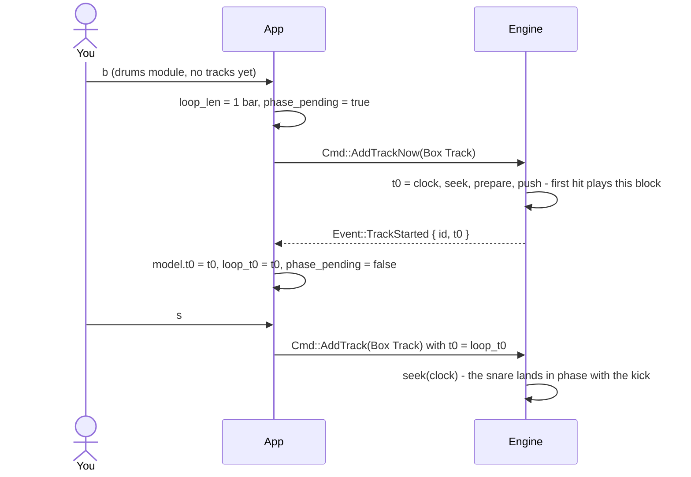

Later drum tracks (and drums added to an existing loop) use `t0 = loop_t0`
and the normal `AddTrack`, so all drums share one grid. Synth and voice loops
recorded afterwards get `len = n × loop_len`, i.e. whole bars.

**Drum synthesis** (`DrumVoice`, one per track, retriggered by each hit):

| Drum | Sound source | `tone` | `punch` | decay (× `ddecay`) |
| --- | --- | --- | --- | --- |
| kick | sine at 48 Hz × tune, pitch envelope sweeping down from up to 6× | noise click | depth/length of the pitch drop, saturation | 0.45 s |
| snare | 185 Hz sine body + noise through a 1.2 kHz high-pass | body ↔ noise balance | body pitch snap | body 0.12 s, noise 0.22 s |
| hihat | six square oscillators at the TR-808 ratios (205.3, 304.4, 369.6, 522.7, 540, 800 Hz) + noise, two high-passes at 6–10 kHz | high-pass frequency | transient spike | 0.07 s |
| cymbal | same metal source, high-passes at 3.5–8 kHz | high-pass frequency | transient spike | 1.3 s |

Envelopes are exponential (`t60` multipliers). When both envelopes have
decayed below −80 dB, the voice outputs silence without computing anything.
The track's `Fx` follows, so drums get drive, crush, filters, echo and reverb
like any other track.

---

## 9. The parameter system

`params.rs` defines every parameter once, in a macro-generated table:

```rust
CUTOFF = "cutoff", 40.0, 18000.0, 3000.0, Exp(1.122), Hz, SYN, "low-pass filter cutoff";
//        name     min    max      default step        fmt scope help
```

- `Params = [f32; 44]`. Every sound (live synth, live voice, drum defaults,
  master, each track) is one such array, so there are no maps or strings on
  the audio thread. The engine indexes by constant (`p::CUTOFF`).
- **Scope flags** decide where a parameter is valid: `SYN`, `VOX`, `DRM`,
  `MST`, `LIVE` (live input only: `monitor`, `ingain`) and `TRK` (tracks
  only: `reverse`, `drum`, `rate`, `offset`). The FX parameters carry
  `SYN | VOX | DRM`. `Scope::{Synth, Voice, Drum}{track}` and
  `Scope::Master`, via `Scope::applies`, filter pages, `show`, presets and
  copy/paste.
- **Steps**: `Lin(step)` adds and `Exp(ratio)` multiplies, which is right for
  frequencies and times. Coarse steps are ×5 linear or ratio⁶. Choices wrap
  and toggles flip.
- **Pages**: control mode shows up to 10 parameters per page, mapped to the
  key columns `q/a … p/;`.

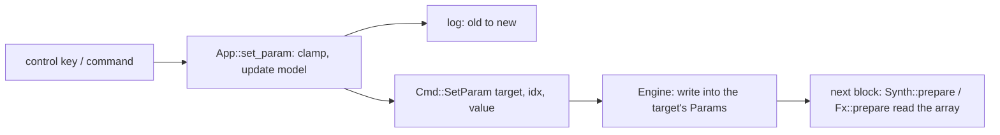

The UI's copy is the source of truth, used for display, saving and presets.
The engine's copy is a mirror updated by `SetParam`. Applying a whole sound
(paste, preset, reset) sends one `SetParam` per changed value.

---

## 10. Input: keyboard and MIDI

### Keyboard

crossterm reads keys in raw mode. When the terminal supports the **kitty
keyboard protocol**, kudio enables `REPORT_EVENT_TYPES` (press / repeat /
release) and `REPORT_ALTERNATE_KEYS`. Shifted keys then arrive as their
base key plus Shift, so `keymap::base_char` maps `Z`→`z`, `<`→`,` and so
on, and Shift never changes the note.

Without release events (legacy terminals), the **gate fallback** applies.
Each held note gets an expiry time (`gate`, 0.35 s), and the UI loop
releases notes whose time has passed. Terminals auto-repeat only the *most
recently pressed* key, so for a chord only the last key keeps repeating.
Therefore any repeat (which arrives as a press of an already-held key)
extends the expiry of **all** held notes, not just its own. Chords then
sustain while any key is held, and every note stops `gate` seconds after the
last repeat. The trade-off is that a key released early in a chord keeps
sounding until the others are released. That can't be told apart without
release events.

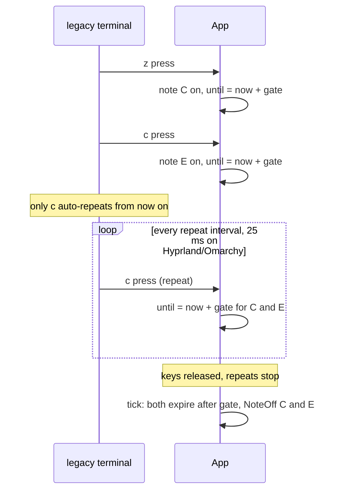

In the drums module, keys are actions rather than notes. A legacy repeat
(the same key again within 300 ms) is ignored, so holding `b` doesn't
flicker the mute. With the kitty protocol, `Repeat` events are ignored
directly.

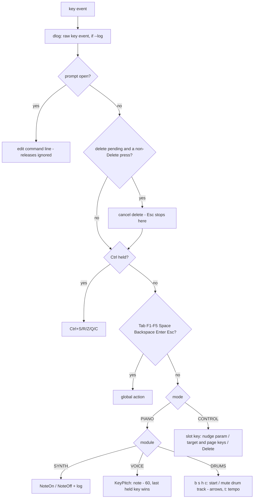

### MIDI

`midi.rs` uses `midir` (ALSA sequencer on Linux). `Midi::poll`, called from
the UI loop, rescans ports every 2 s. It connects to the first port that
matches the filter (by default any port whose name doesn't contain
"Through"). If the port disappears it logs the disconnect and reconnects
later. If `/dev/snd/seq` doesn't exist, scanning is skipped, so alsa-lib
can't spam stderr.

`parse()` maps:

| MIDI message | Cmd |
| --- | --- |
| Note On (vel > 0) | `NoteOn(note, vel)` |
| Note Off / Note On vel 0 | `NoteOff(note)` |
| CC 64 | `Sustain(value ≥ 64)` |
| CC 1 | `ModWheel(value / 127)`: adds up to 0.5 st vibrato |
| CC 120 / 123 | `Panic` |
| Pitch bend | `Bend(±2 semitones)` |

Commands go straight into the engine's MIDI queue from the midir callback
thread. A copy goes to the UI over `mpsc`, for logging only.

---

## 11. Sessions, presets, takes

### Layout

```text
$KUDIO_HOME (default ~/Music/kudio)
├── sessions/<name>/session.json
├── sessions/<name>/tracks/<id:03>.wav     voice tracks, mono f32
├── sessions/<name>/takes/take-<n:03>.wav  performance recordings, stereo f32
└── presets/<name>.json
```

### `session.json`

```json
{
  "version": 1,
  "sample_rate": 48000,
  "loop_len": 60928,
  "loop_t0": 34816,
  "master":     { "volume": 0.8, "roomsize": 0.7, "damp": 0.4 },
  "live_synth": { "wave": 2.0, "cutoff": 3000.0, "...": 0 },
  "live_voice": { "pitch": 0.0, "monitor": 0.0, "...": 0 },
  "live_drums": { "tune": 0.0, "ddecay": 1.0, "...": 0 },
  "bpm": 120.0,
  "tracks": [
    { "id": 1, "name": "synth-1", "kind": "synth", "len": 60928, "t0": 34816,
      "muted": false, "params": { "cutoff": 800.0, "...": 0 },
      "events": [ { "at": 0, "type": "on", "note": 48, "vel": 100 },
                  { "at": 7680, "type": "off", "note": 48 } ] },
    { "id": 2, "name": "voice-2", "kind": "voice", "len": 60928, "t0": 1536,
      "muted": true, "params": { "reverb": 0.15, "...": 0 }, "audio": "tracks/002.wav" },
    { "id": 3, "name": "snare-3", "kind": "drum", "len": 60928, "t0": 34816,
      "muted": false, "params": { "drum": 1.0, "rate": 1.0, "offset": 4.0, "...": 0 }, "bars": 1 }
  ]
}
```

- Parameters are stored **by name**, so the files stay readable and survive
  adding or reordering parameters. Unknown names are ignored on load (with a
  warning), and missing ones fall back to defaults.
- `t0` and `loop_t0` are stored modulo their length. Only the phase matters,
  because on load every track is re-seeked against the running clock.
- **Saving** writes each voice track's WAV once (its audio never changes
  after recording), then writes `session.json.tmp` and renames it over
  `session.json`. That makes the save atomic: a crash mid-save leaves the old
  session intact. WAVs of deleted tracks are removed.
- **Loading** converts `len`, `t0`, event times and `loop_len` to the
  current sample rate if it differs, and linearly resamples voice audio.
  Tracks are rebuilt and added with `seek(clock)`, so they resume in their
  stored relative phase.
- **Presets** are `{ "kind": "synth" | "voice" | "drum" | "master", "params": {…} }`,
  restricted to the parameters valid for that scope.
- `live_drums`, `bpm` and a track's `bars` are optional (`serde(default)`),
  so sessions saved before the drums module existed still load.

### Takes (session recording)

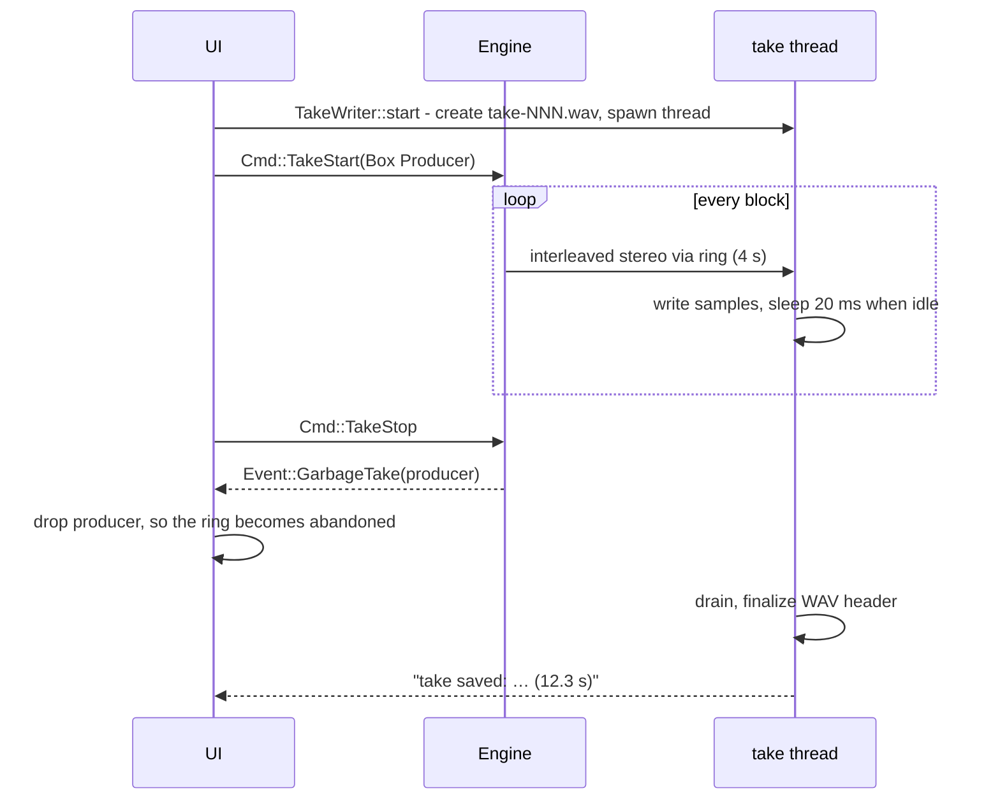

At exit, `TakeWriter::join` also sets a stop flag and waits up to 3 s. That
way the file is finalized even if the audio backend keeps the callback (and
with it the producer) alive after the stream is dropped.

---

## 12. Real-time safety rules

The output callback must finish within one buffer period (about 5 ms at the
defaults), every time. Inside `Engine` these rules hold:

| Rule | How it is enforced |
| --- | --- |
| **No locks** | Only `rtrb` SPSC queues. The one `Mutex` (engine hand-off slot) uses `try_lock`, and only until the engine has been taken. |
| **No allocation** | All buffers (`l`, `r`, `rev`, `buf`, `vbuf`, 1024 frames) are allocated in `Engine::new`. `tracks` is pre-reserved for 64. Tracks, synths, delay lines and take producers are built on the UI thread and moved in as `Box`es. |
| **No deallocation** | A removed track, or a replaced take producer, is sent back as `Event::Garbage` / `Event::GarbageTake`, and the UI thread drops it. (If the event queue were ever full, the drop would happen on the audio thread. With a 16384-slot queue drained every 8 ms that doesn't happen in practice.) |
| **No I/O or syscalls** | Logging, saving and WAV writing happen on other threads, fed by queues. `dlog!` is never called from the engine. |
| **Bounded work** | 8 voices per synth, 64 tracks, and blocks of at most 1024 frames. Unused FX stages are skipped. |
| **Never block on a full queue** | The engine drops data and reports a single `Overflow` event instead. |
| **Clock drift** | Mic input and output run on separate device clocks. The engine keeps at most 30 ms of mic backlog and skips older samples. |

The UI applies the same discipline in the other direction. It never waits on
the engine; it sends a command and later reacts to the resulting event.

---

## 13. Startup and shutdown

```mermaid
sequenceDiagram
    participant M as main
    participant A as audio.rs
    participant E as Engine
    participant UI as App
    M->>M: parse args (--help / --list-devices exit here)
    M->>M: --log: devlog::init (truncate file), log args and TERM
    M->>A: audio::start(options)
    A->>A: pick output (48 kHz preferred), optional mic at the same rate
    A->>E: Engine::new(sr, mic ring)
    A->>A: build output stream (fixed buffer, falling back to device default)
    A-->>M: Audio handles + EngineLink (queue ends)
    M->>M: Midi::new(midi queue)
    M->>M: raw mode, probe + push kitty flags (probe result to dlog), hide cursor, panic hook restores terminal and flushes dlog
    M->>UI: App::new(link, …)
    M->>UI: load session if it exists; start take if -r
    M->>UI: app.run() - poll keys, drain events/capture/logs, MIDI scan, footer
    UI-->>M: quit
    M->>UI: autosave session
    M->>A: drop streams (audio stops)
    M->>M: join take writers (bounded 3 s)
    M->>M: restore terminal, print "bye!"
```

The panic hook restores the terminal (raw mode, keyboard flags, cursor)
before printing the panic, so a bug never leaves the shell unusable.

---

## 14. Testing

`cargo test` runs 34 unit tests that need no audio hardware:

- **dsp**: ADSR full cycle, SVF DC response, pitch shifter bypass, soft-clip
  bounds.
- **drums**: default pattern hit positions (1 and 2 bars), offsets wrapping
  inside the interval, every drum producing bounded sound.
- **synth**: notes sound and release, the sustain pedal holds, voice
  stealing caps polyphony.
- **track**: seeking with any `t0`/`clock`, event playback and wrap, a drum
  track hitting exactly on the beat and wrapping, JSON shape of events.
- **engine**: a synth recording waits for the first note, voice capture,
  `AddTrackNow` reports its start frame, removed tracks come back as
  garbage.
- **app**: event folding closes held notes and wraps, releases sort before
  presses, audio folding overlays the overflow, meter rendering.
- **params**: parsing (`2k`, `50%`, `20ms`, names, `1/8`, `2x`), formatting,
  scopes (including drum scopes), nudging/wrapping, defaults in range.
- **keymap / midi**: note names, Shift normalization, knob slots, MIDI
  parsing.
- **session**: save/load round trip with synth, voice and drum tracks plus
  bpm (with `KUDIO_HOME` pointed at a temp dir), resampling, name
  sanitizing.

The engine can be driven entirely from tests by calling `Engine::process`
on a plain `Vec<f32>`. This is also how to profile or reproduce DSP issues
offline.

---

## 15. Developer log

`--log[=PATH]` (default `./kudio.log`) turns on a development log. It's
meant for debugging, not users, so it was built to be as cheap as possible
in code, binary size and runtime:

- **No dependencies.** `devlog.rs` is about 60 lines of `std`: a
  `static LOG: OnceLock<Log>` holding a `Mutex<LineWriter<File>>` and a start
  `Instant`.
- **Free when off.** `dlog!(...)` expands to
  `if devlog::enabled() { devlog::write(format_args!(...)) }`. `enabled()`
  is an inlined `OnceLock::get().is_some()` (one atomic load), and the
  arguments are never formatted unless the log is on.
- **Crash-safe.** `LineWriter` flushes at every newline, so a killed process
  loses nothing. The panic hook logs the panic and flushes before restoring
  the terminal.
- **One choke point.** `Term::log` mirrors every user-visible line (tag +
  text, no colors), so the dev log is a superset of the screen.

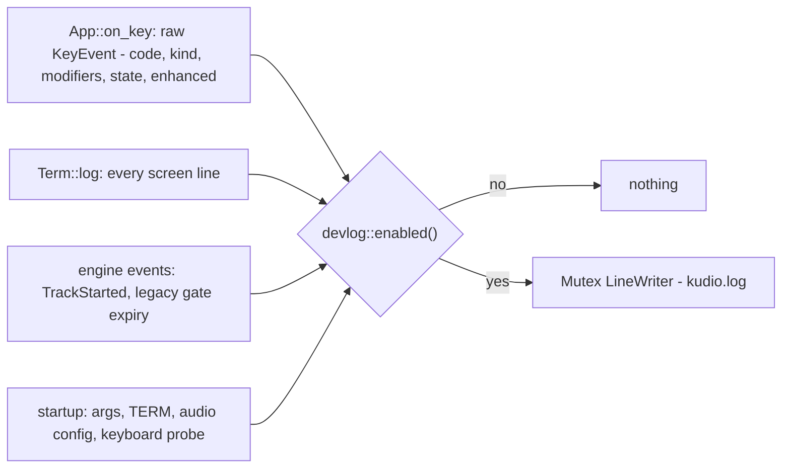

The raw key lines are the main reason it exists. They show whether the
terminal sends releases (`Release`), auto-repeats (`Repeat`, or repeated
`Press` in legacy mode), and how it reports Shift. That's exactly what you
need to diagnose "chords don't work" or "stuck notes" in a particular
terminal. Only the UI thread writes to it; the audio thread never does.
