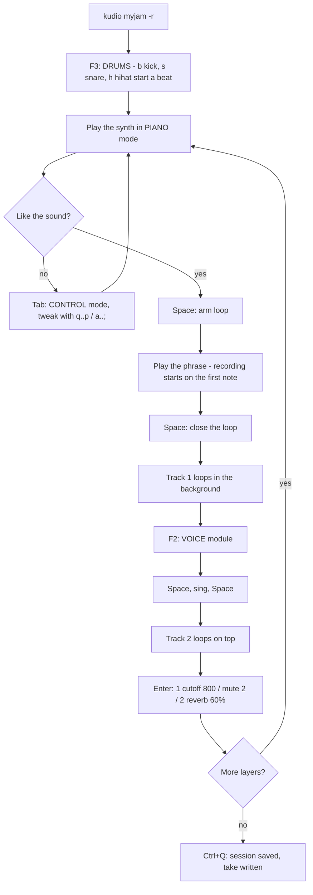
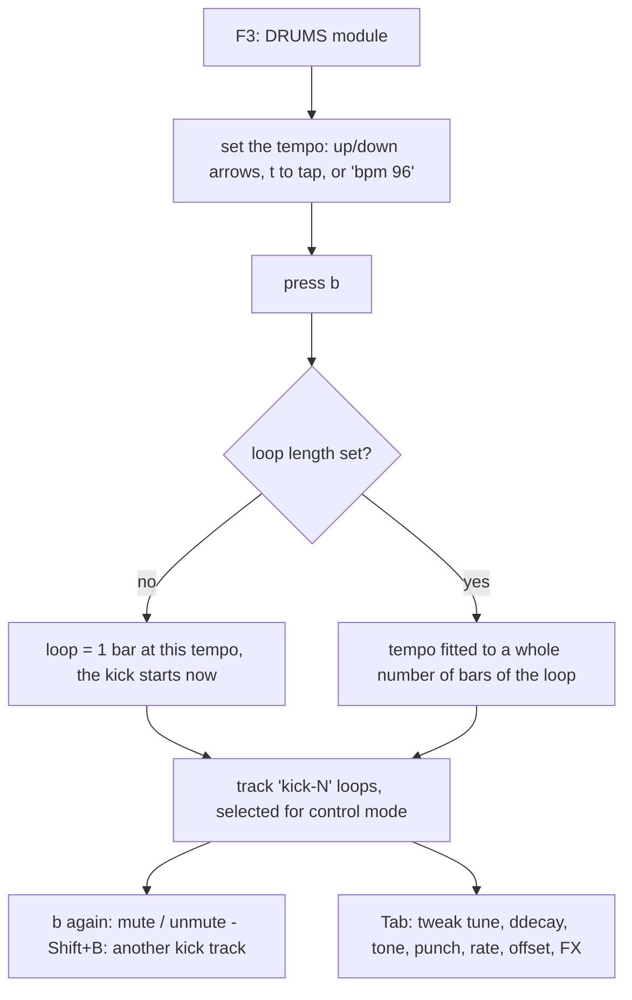

# kudio user manual

kudio turns your computer keyboard (and, optionally, a USB MIDI piano) into a
live-looping instrument that runs in a terminal. This manual covers:

1. [Starting a session](#1-starting-a-session)
2. [The screen](#2-the-screen)
3. [A jam, step by step](#3-a-jam-step-by-step)
4. [Modules and modes](#4-modules-and-modes)
5. [Key reference](#5-key-reference)
6. [Command reference](#6-command-reference)
7. [Sound parameters](#7-sound-parameters)
8. [Looping in detail](#8-looping-in-detail)
9. [Drums](#9-drums)
10. [Voice and microphone](#10-voice-and-microphone)
11. [Digital piano (USB MIDI)](#11-digital-piano-usb-midi)
12. [Sessions, presets and recordings](#12-sessions-presets-and-recordings)
13. [Troubleshooting](#13-troubleshooting)
14. [Developer log](#14-developer-log)

---

## 1. Starting a session

```sh
kudio                     # new session named session-YYYYMMDD-HHMMSS
kudio myjam               # open "myjam", or create it if it does not exist
kudio myjam -r            # ...and record the whole performance to a WAV file
```

| Option            | Meaning                                                              |
| ----------------- | -------------------------------------------------------------------- |
| `-r`, `--record`  | Record the master output to `takes/take-NNN.wav` from the start      |
| `--midi <NAME>`   | Only connect to a MIDI input whose name contains NAME                |
| `--no-midi`       | Do not look for MIDI devices                                         |
| `--no-mic`        | Do not open the microphone (the voice module is disabled)            |
| `--output <NAME>` | Audio output device (substring of a name from `--list-devices`)      |
| `--input <NAME>`  | Microphone device (substring match)                                  |
| `--buffer <N>`    | Audio buffer in frames; default 256 (≈5 ms). Lower = less latency    |
| `--list-devices`  | Print audio devices and MIDI inputs, then exit                       |
| `--log[=PATH]`    | Developer log to `./kudio.log` (or PATH), see [section 14](#14-developer-log) |

The session is **saved automatically when you quit**. You can also save at
any time with `Ctrl+S`.

### Terminal

Use **kitty, ghostty, alacritty, foot or wezterm**. These report key
*releases*, so a note lasts exactly as long as you hold its key. kudio prints
`keyboard: key press + release detected ✓` at startup when that works.

In other terminals kudio falls back to fixed-length notes. Each key press
plays a note for `gate` seconds (0.35 s by default), and holding the key
keeps extending it. Change the length with the `gate` command, e.g. `gate 0.8`.

**Chords in fallback mode:** these terminals only repeat the *last* key you
pressed. So while any piano key keeps repeating, kudio keeps *every* sounding
note alive, which means held chords work. The catch is that a note you
released early keeps sounding until you let go of the last key. In a
terminal with key-release support, every note stops exactly when you
release its key.

---

## 2. The screen

Everything you do is printed as a timestamped log line. The bottom of the
terminal shows a status **footer**, drawn in reverse video:

```text
[00:03.399] SYNTH ♪ C3   ( 48)  vel 100  ●rec
[00:04.679] CTRL  track 1 'synth-1' · cutoff 3.00 kHz → 800.0 Hz
 oct 3 (z=C3, q=C4) vel 100 voices 2 │ Space loop · ⌫ cancel · Tab control · F1 synth F2 voice F3 drums
 SYNTH·PIANO │ loop 1.27s ▰▰▰▰▱▱▱▱ │ ● REC synth 0.8s │ 2 trk │ out ▮▮▮··· │ mic ······ │ midi Digital Piano
```

The bottom line shows, in order:

- **module·mode**: `SYNTH·PIANO`, `VOICE·CONTROL`, and so on.
- **loop length and playhead**: each `▰` is one eighth of the loop.
- **recording state**: `◌ ARMED` or `● REC`.
- **number of tracks**.
- **output and microphone meters**: a `!` means clipping.
- **connected MIDI device**.

In control mode the footer instead shows the selected target and the current
page of parameters, with the keys that raise and lower each one.

Log categories:

| Tag     | Meaning                                       |
| ------- | --------------------------------------------- |
| `SYNTH` | notes played on the synth from the keyboard   |
| `VOICE` | voice module: pitch keys, monitor             |
| `DRUM`  | drums module: drum tracks started, tempo      |
| `MIDI`  | notes / pedal from the piano, connect events  |
| `LOOP`  | loop armed / recording / recorded             |
| `CTRL`  | a parameter changed (old → new)               |
| `TRACK` | track list, mute, solo, delete, rename        |
| `SESS`  | save, load, presets, WAV takes                |
| `CMD`   | the command you typed                         |
| `WARN` / `ERROR` | something did not work, and why      |

Note-off lines are hidden by default. `verbose` shows them.

---

## 3. A jam, step by step

This is the workflow kudio is built around.



1. **Start** with `kudio myjam`. Add `-r` if you want the whole performance
   written to a WAV file. You can also start and stop that recording at any
   time with `Ctrl+R`.
   *Optional: start with a beat.* Press **F3** for the drums module, set
   the tempo with `↑` `↓` (or type `bpm 100` at the prompt), then press `b`.
   A kick drum starts looping straight away. Add `s` (snare) and `h`
   (hihat). The beat sets the loop length to one bar, and everything you
   record later snaps to whole bars. See [Drums](#9-drums).
2. **Find a sound.** In piano mode, the bottom letter row `z x c v b n m , . /`
   is a white-key octave, with black keys on `s d g h j l ;`. The top row
   `q w e r t y u i o p [ ]` is the octave above, with black keys on
   `2 3 5 6 7 9 0 =`. `←` `→` change octave and `↑` `↓` change velocity.
   Press **Tab** for control mode. The footer shows ten parameters: `q`
   raises the first one and `a` lowers it, `w`/`s` do the second, and so on.
   Hold **Shift** for big steps. `]` goes to the next page
   (osc → env/filter/lfo → fx). Press **Tab** again to play.
3. **Record a loop.** Press **Space**. The log says
   `◌ armed: synth loop starts with your first note`. Play your phrase.
   Recording starts on the first note, so you don't need to hit Space exactly
   on the beat. Press **Space** again at the moment the loop should wrap
   around. The phrase becomes **track 1** and starts looping immediately. Its
   length is now the session's *loop length*, and every later loop snaps to
   it.
4. **Change the sound and add more.** The live synth is independent of track
   1, so changing knobs now won't affect the loop. Press Space, play,
   Space → track 2. Later loops start recording the moment you press Space.
   When you close the loop it is rounded to a whole number of loop lengths
   (1×, 2×, 3×…).
5. **Sing.** Press **F2** for the voice module. Press **F4** if you want to
   hear yourself, but use headphones or you'll get feedback. Space, sing,
   Space → a voice track. In piano mode the note keys pitch-shift your voice
   while held (`q` = C4 = unchanged, `w` = +2 semitones, `z` = −12).
6. **Go back and tweak earlier loops.** Two ways:
   - **Keyboard:** in control mode, press `1`–`9` to select a track, or
     `` ` `` for the live sound and `0` for master. Then tweak it the same
     way you tweak the live synth. `m` mutes the selected track, `n` solos it,
     and `Delete` twice deletes it (`Esc` cancels).
   - **Commands:** press **Enter** and type, e.g.
     `1 cutoff 800`, `2 reverb 60%`, `set 3 pitch -12 reverse on`, `mute 2`.
7. **Reuse sounds.** `preset save fatbass 1` saves track 1's sound.
   Next session, `preset load fatbass live` loads it onto the live synth.
8. **Quit** with **Ctrl+Q**. The session is saved: tracks, their sounds,
   the loop length and the live sound. `kudio myjam` brings it all back.

---

## 4. Modules and modes

kudio has **three modules**, which are the sound sources your keyboard is aimed
at, and **two modes**, which are what the keys do.

|                    | PIANO mode (keys = notes)                        | CONTROL mode (keys = knobs)                       |
| ------------------ | ------------------------------------------------ | ------------------------------------------------- |
| **SYNTH** (F1)     | play the synth                                   | tweak the live synth, a track, or master          |
| **VOICE** (F2)     | hold a key to pitch-shift your live voice        | tweak the live voice (FX, pitch, monitor, gain), a voice track, or master |
| **DRUMS** (F3)     | `b` `s` `h` `c` start/mute drum loops, arrows set the tempo | tweak a drum track, the defaults for new drum tracks, or master |

- **Space** records a loop from the *current module*: a synth loop in SYNTH,
  a microphone loop in VOICE. This works in both modes. Drum tracks don't need
  recording: they loop as soon as you start them.
- A **MIDI piano always plays the synth**, whatever module or mode you're in.
  A good setup: play the piano with one hand and stay in control mode on the
  computer keyboard to shape the sound as you play.
- In control mode the **target** (shown in the footer) is what the knobs
  change:
  - `` ` ``: the **live** sound of the current module (what you're playing now)
  - `1`–`9`: **track** 1–9. Use `,` `.` to step through all targets,
    including tracks 10 and above.
  - `0`: **master** (volume, reverb room size, damping)

---

## 5. Key reference

### Global (both modes)

| Key           | Action                                                             |
| ------------- | ------------------------------------------------------------------ |
| `Tab`         | toggle PIANO / CONTROL mode                                        |
| `F1` / `F2` / `F3` | SYNTH / VOICE / DRUMS module                                  |
| `F4`          | microphone monitoring on/off                                       |
| `F5`          | print the key map                                                  |
| `Space`       | arm/start a loop recording · press again to close the loop         |
| `Backspace`   | cancel the recording in progress (nothing is kept)                 |
| `Enter`       | open the command prompt                                            |
| `Esc`         | panic: all notes off, voice pitch reset                            |
| `Ctrl+S`      | save the session                                                   |
| `Ctrl+R`      | start/stop recording the session to a WAV take                     |
| `Ctrl+Z`      | delete the most recently added track                               |
| `Ctrl+Q` / `Ctrl+C` | quit (autosaves)                                             |

### Piano mode

```text
 upper octave (q = C of octave+1)
   2   3       5   6   7       9   0       =
 q   w   e   r   t   y   u   i   o   p   [   ]
 C   D   E   F   G   A   B   C   D   E   F   G

 lower octave (z = C of current octave)
   s   d       g   h   j       l   ;
 z   x   c   v   b   n   m   ,   .   /
 C   D   E   F   G   A   B   C   D   E
```

| Key       | Action                                     |
| --------- | ------------------------------------------ |
| `←` / `→` | octave down / up (0–7, default 3: z = C3)  |
| `↑` / `↓` | velocity ±8 (default 100)                  |

Shift doesn't change which note a key plays, so a stray Shift can't knock you
off your scale.

### Piano mode in the DRUMS module

| Key                 | Action                                                               |
| ------------------- | -------------------------------------------------------------------- |
| `b` `s` `h` `c`     | kick, snare, hihat, cymbal. First press starts a looping drum track; the next press mutes/unmutes the newest track of that drum |
| `Shift` + `b s h c` | always add *another* track of that drum (e.g. a second kick pattern) |
| `↑` / `↓`           | tempo +1 / −1 bpm                                                    |
| `→` / `←`           | tempo +10 / −10 bpm                                                  |
| `t`                 | tap tempo: tap it on the beat 2–5 times                              |

The tempo can only change while there is no loop yet (see [Drums](#9-drums)).

### Control mode

| Key                         | Action                                                    |
| --------------------------- | --------------------------------------------------------- |
| `q w e r t y u i o p`       | raise parameter 1–10 of the page                          |
| `a s d f g h j k l ;`       | lower parameter 1–10                                      |
| `Shift` + any of the above  | big step (×5 for linear values, ×6 steps for frequencies/times) |
| `↑` `↓`                     | move the cursor `›` between parameters                    |
| `←` `→`                     | lower / raise the parameter under the cursor              |
| `[` `]`                     | previous / next page                                      |
| `` ` ``                     | target the live sound                                     |
| `1`–`9`                     | target track 1–9                                          |
| `0`                         | target master                                             |
| `,` `.`                     | previous / next target                                    |
| `z`                         | reset the parameter under the cursor to its default       |
| `x`                         | print every parameter of the target                       |
| `c` / `v`                   | copy / paste the target's whole sound                     |
| `m` / `n`                   | mute / solo the selected track                            |
| `Delete`                    | delete the selected track: press once to arm, again to confirm. `Esc` (or any other key) cancels |

Keys repeat while held, so holding `q` sweeps the parameter up.
Waveform choices wrap around, so one key cycles sine → tri → saw → square.
On/off parameters toggle.

---

## 6. Command reference

Press **Enter**, type a command, then press **Enter** again. Use `Esc` to
cancel, `↑`/`↓` for history and `Ctrl+U` to clear the line. Tracks are
referenced by their **number** in the `tracks` list.

**Targets:** `1`, `2`, … (track number), `live` (the current module's live
sound), `synth`, `voice` (alias `mic`), `drums` (the defaults for new drum
tracks), `master`, and `sel` (whatever control mode has selected).

### Tracks

| Command                       | Example              | What it does                                        |
| ----------------------------- | -------------------- | --------------------------------------------------- |
| `tracks`                      | `tracks`             | list tracks: number, name, kind, length, state, sound |
| `mute <n…>` / `unmute <n…>`   | `mute 2 3`           | silence / un-silence tracks (they keep running)     |
| `solo <n…>` / `unsolo <n…>`   | `solo 1`             | only soloed tracks are heard                         |
| `del <n>`                     | `del 3`              | delete a track (later tracks move up). In control mode: select it, `Delete` twice |
| `name <n> <name>`             | `name 1 bassline`    | rename                                              |
| `dup <n>`                     | `dup 1`              | duplicate a track (then tweak the copy)             |
| `clear all`                   | `clear all`          | delete every track and reset the loop length        |

### Sound

| Command                            | Example                          | What it does                                  |
| ---------------------------------- | -------------------------------- | --------------------------------------------- |
| `set <t> <param> <value> …`        | `set 2 cutoff 800 reso 60%`      | set one or more parameters                    |
| `<t> <param> <value> …`            | `2 dmix 30%`                     | shorthand for `set`                           |
| `show <t>`                         | `show 1`                         | all parameters; `*` marks non-default values  |
| `reset <t> [param …]`              | `reset 2 cutoff`                 | back to defaults (all params if none given)   |
| `copy <from> <to>`                 | `copy 1 live`                    | copy a whole sound                            |
| `sel <t>`                          | `sel 3`                          | point control mode at a target                |
| `help <param>`                     | `help wobble`                    | range, default and meaning of a parameter     |

**Values** can be written as:

| Form          | Example                    | Meaning                                  |
| ------------- | -------------------------- | ---------------------------------------- |
| plain number  | `800`, `0.6`, `-12`        | in the parameter's own unit              |
| kilo          | `2k`, `1.5k`               | ×1000 (frequencies)                      |
| percent       | `50%`                      | for 0–1 parameters                       |
| milliseconds  | `20ms`                     | for times                                |
| names         | `saw`, `square`, `snare`, `1/8`, `on`, `off` | waveforms, drums, rates and toggles |
| multiplier    | `2x`                       | for `ddecay`                             |
| relative      | `*2`, `+=3`, `-=3`         | multiply / add to the current value      |

Values outside the allowed range are clamped. The log shows the value that
was actually applied.

### Presets

| Command                         | Example                  |                                           |
| ------------------------------- | ------------------------ | ----------------------------------------- |
| `preset save <name> [t]`        | `preset save pad 2`      | save the sound of target t (default: the control-mode selection) |
| `preset load <name> [t]`        | `preset load pad live`   | apply a saved sound to a target           |
| `presets`                       |                          | list saved presets                        |

Presets are shared between all sessions. Loading a synth preset onto a voice
target, or the reverse, applies only the parameters they share (the FX).

### Session

| Command                 |                                                                       |
| ----------------------- | --------------------------------------------------------------------- |
| `save [name]`           | save. With a name, this is "save as": the session continues under the new name |
| `load <name>`           | save the current session, then open another one                       |
| `sessions`              | list saved sessions                                                   |
| `rec`                   | start/stop recording the session to WAV (same as `Ctrl+R`)            |
| `loop`                  | print the loop length                                                 |
| `loop <seconds>`        | set the loop length before recording anything, e.g. `loop 4` for a 4 s grid (only allowed while there are no tracks) |
| `loop clear`            | forget the loop length (only allowed while there are no tracks)       |

### Live performance

| Command                      |                                                                  |
| ---------------------------- | ---------------------------------------------------------------- |
| `synth` / `voice` / `drums`  | switch module                                                    |
| `drums <kick\|snare\|hihat\|cymbal>` | add a drum track (like Shift + its key)                   |
| `bpm [n]`                    | show the tempo, or set it (40–300, before the first loop)        |
| `monitor on\|off`            | hear the microphone live                                         |
| `octave <0-7>` · `vel <1-127>` | keyboard octave / velocity                                     |
| `gate <seconds>`             | note length on terminals without key-release support            |
| `midi`                       | MIDI status and list of inputs                                   |
| `midi <n>` / `midi <name>`   | connect to input n of the list, or one whose name contains name  |
| `midi off`                   | disconnect                                                       |
| `verbose [on\|off]`          | also log note-offs and other low-level events                    |
| `help [keys\|commands\|<param>]` |                                                              |
| `quit`                       | save and exit                                                    |

---

## 7. Sound parameters

Every sound (the live synth, the live voice, each track, and master) is a set
of named parameters. `show <t>` lists them and `help <param>` explains one.

### Synth: page 1 "osc"

| Key | Param    | Range           | Default | Meaning                                      |
| --- | -------- | --------------- | ------- | -------------------------------------------- |
| q/a | `wave`   | sine/tri/saw/square | saw | oscillator 1 waveform                        |
| w/s | `wave2`  | sine/tri/saw/square | saw | oscillator 2 waveform                        |
| e/d | `semi2`  | −24…+24 st      | 0       | oscillator 2 interval (7 = fifth, 12 = octave) |
| r/f | `detune` | 0…50 cents      | 8       | oscillator 2 detune (fatness)                |
| t/g | `mix`    | 0…100 %         | 50 %    | oscillator 2 level                           |
| y/h | `sub`    | 0…100 %         | 0       | sine one octave below                        |
| u/j | `noise`  | 0…100 %         | 0       | white noise                                  |
| i/k | `octave` | −3…+3           | 0       | transpose                                    |
| o/l | `glide`  | 0…1 s           | 0       | portamento                                   |
| p/; | `vel`    | 0…100 %         | 70 %    | how much velocity affects loudness           |

### Synth: page 2 "env/filter/lfo"

| Key | Param     | Range          | Default | Meaning                                   |
| --- | --------- | -------------- | ------- | ----------------------------------------- |
| q/a | `attack`  | 1 ms…5 s       | 5 ms    | envelope attack                           |
| w/s | `decay`   | 5 ms…5 s       | 300 ms  | envelope decay                            |
| e/d | `sustain` | 0…100 %        | 70 %    | sustain level                             |
| r/f | `release` | 5 ms…8 s       | 250 ms  | release after the key is let go           |
| t/g | `cutoff`  | 40 Hz…18 kHz   | 3 kHz   | low-pass filter cutoff                    |
| y/h | `reso`    | 0…100 %        | 20 %    | filter resonance                          |
| u/j | `fenv`    | −4…+6 oct      | +1.5    | how far the envelope opens the filter     |
| i/k | `lforate` | 0.05…20 Hz     | 4 Hz    | LFO speed                                 |
| o/l | `vibrato` | 0…2 st         | 0       | LFO → pitch                               |
| p/; | `wobble`  | 0…4 oct        | 0       | LFO → cutoff (dubstep wobble)             |

### FX: page 3 for synth, page 1 for voice. Applies to live sounds and every track.

| Key | Param    | Range            | Default | Meaning                                |
| --- | -------- | ---------------- | ------- | -------------------------------------- |
| q/a | `level`  | 0…150 %          | 80 %    | volume                                 |
| w/s | `pan`    | −1…+1            | 0       | left / right                           |
| e/d | `drive`  | 0…100 %          | 0       | saturation                             |
| r/f | `crush`  | 0…100 %          | 0       | bit-crusher / sample-rate reducer      |
| t/g | `hp`     | 20 Hz…2 kHz      | 20 (off) | high-pass (thin a sound out)          |
| y/h | `lp`     | 200 Hz…20 kHz    | 20k (off) | low-pass (darken; works on voice too)|
| u/j | `dtime`  | 10…1000 ms       | 375 ms  | echo time                              |
| i/k | `dfb`    | 0…95 %           | 35 %    | echo repeats                           |
| o/l | `dmix`   | 0…100 %          | 0       | echo amount                            |
| p/; | `reverb` | 0…100 %          | 15 %    | send to the shared reverb              |

### Voice: page 2 "voice"

| Param     | Range       | Default | Meaning                                                    |
| --------- | ----------- | ------- | ---------------------------------------------------------- |
| `pitch`   | −24…+24 st  | 0       | pitch shift (live voice and voice tracks)                  |
| `reverse` | on/off      | off     | play the loop backwards (*tracks only*)                    |
| `monitor` | on/off      | off     | hear the mic live (*live only*; same as F4)                |
| `ingain`  | 0…400 %     | 100 %   | microphone gain (*live only*)                              |

The page only lists parameters that apply to the target. On the live voice
that's `pitch` (q/a), `monitor` (w/s) and `ingain` (e/d). On a voice track
it's `pitch` (q/a) and `reverse` (w/s).

### Drums: page 1 "drum" (page 2 is FX)

| Param    | Range                      | Default | Meaning                                              |
| -------- | -------------------------- | ------- | ---------------------------------------------------- |
| `drum`   | kick/snare/hihat/cymbal    | —       | the instrument (*tracks only*)                       |
| `tune`   | −24…+24 st                 | 0       | pitch                                                |
| `ddecay` | ×0.1…×4                    | ×1      | length of the hit                                    |
| `tone`   | 0…100 %                    | 50 %    | kick: click · snare: more rattle, less body · hihat/cymbal: brightness |
| `punch`  | 0…100 %                    | 50 %    | attack: kick pitch drop, snare snap, hat transient   |
| `rate`   | 1/1, 1/2, 1/4, 1/8, 1/16   | per drum | how often it hits (1/4 = every beat) (*tracks only*) |
| `offset` | 0…15 sixteenths            | per drum | shift the hits later; 2 with rate 1/4 = off-beats (*tracks only*) |

On the live target of the drums module (`` ` `` in control mode, or `drums`
at the prompt), you edit the **defaults for new drum tracks**. That target has
`tune`, `ddecay`, `tone`, `punch` and the FX.

New tracks start with these patterns:

| Drum   | rate | offset | Plays                    |
| ------ | ---- | ------ | ------------------------ |
| kick   | 1/4  | 0      | every beat (four on the floor) |
| snare  | 1/2  | 4      | beats 2 and 4            |
| hihat  | 1/4  | 2      | the off-beats            |
| cymbal | 1/1  | 0      | once per bar             |

### Master (target `0`)

| Key | Param      | Range    | Default | Meaning                    |
| --- | ---------- | -------- | ------- | -------------------------- |
| q/a | `volume`   | 0…150 %  | 80 %    | master volume              |
| w/s | `roomsize` | 0…100 %  | 70 %    | reverb size / tail length  |
| e/d | `damp`     | 0…100 %  | 40 %    | reverb darkness            |

The master bus ends with a soft limiter, so you can stack many loops without
harsh digital clipping. If the `out` meter shows `!`, turn tracks or master
down.

### What a synth track remembers

A synth track stores the **notes** you played (and the sustain pedal) plus a
**copy of the synth patch** at the time you recorded it. Because the notes
are re-synthesized on every pass, you can change *everything* on a synth
track later: waveform, filter, envelope, octave and FX.

A voice track stores the **audio**. You can change its FX, `pitch` (re-pitch
the loop) and `reverse`.

A drum track stores **no audio at all**, only its parameters and its number
of bars. Every hit is synthesized live, so everything about a drum track
stays tweakable, including which drum it is and its rhythm.

---

## 8. Looping in detail

- **The first loop defines the loop length.** For a synth, recording starts
  on your first note and ends when you press Space. For a voice, recording
  starts when you press Space.
- **Every later loop snaps to the grid.** Its length is rounded to the
  nearest whole multiple of the loop length. Press Space roughly at the end
  of the 1st, 2nd or 4th time around and kudio makes it exactly 1×, 2× or
  4×. Anything you played past the end wraps around to the beginning, like
  an overdub, so a note played a little "late" isn't lost.
- **Loops stay in time.** A new loop plays back at the same place in the
  cycle where you recorded it. You can start recording mid-cycle.
- Notes still held when the loop closes are released at the loop end.
- **Backspace** while recording throws the take away. **Ctrl+Z** deletes the
  last track afterwards.
- Loops shorter than 0.1 s, or synth loops with no notes, are discarded with
  a warning.
- If you want a fixed grid rather than the length of your first phrase, use
  `loop <seconds>` before recording anything. For example, 2 bars of 4/4 at
  120 BPM is `loop 4`. Or simply start a drum track first: it sets the loop
  to exactly one bar at the current tempo.

---

## 9. Drums

Press **F3** for the drums module. It has four synthesized drums. Each
key starts a *drum track*, which is a loop like any other: it's listed in
`tracks`, saved with the session, and tweaked, muted, soloed and deleted the
same way.



- **The tempo** (`bpm`, default 120) can be changed with the arrow keys,
  tap tempo (`t`) or the `bpm` command **while there is no loop yet**.
- **The first drum track defines the loop.** If nothing has been recorded
  yet, pressing a drum key sets the loop length to **one bar** (4 beats) at
  the current tempo, and the drum starts on that key press. Synth and voice
  loops you record afterwards snap to whole bars.
- **If a loop already exists** (you recorded a synth phrase first), the drum
  fits itself to that loop. kudio picks the whole number of bars closest to
  the current tempo, adjusts the tempo so the bars fit exactly, and logs it,
  e.g. `tempo fitted to the 3.70 s loop: 2 bars at 129.7 bpm`. From then on
  the tempo is locked. `clear all` starts over.
- **Pressing a drum key again** mutes or unmutes the newest track of that
  drum. `Shift` + key always adds another track. For example, add a second
  kick and set its `rate` to 1/8 and `offset` to 3 for a syncopated pattern.
- **A new drum track is selected automatically.** Press `Tab` and its
  parameters are under your fingers: `q`/`a` instrument, `w`/`s` tune,
  `e`/`d` decay, `r`/`f` tone, `t`/`g` punch, `y`/`h` rate, `u`/`j` offset.
  `]` goes to the FX page (drive, crush, filters, echo, reverb).
- The footer shows the tempo and the state of each drum:
  `·` none, `▶` playing, `■` muted.
- A MIDI piano still plays the synth while you're in the drums module.

---

## 10. Voice and microphone

- kudio uses the system's default input, unless you pass `--input <name>`.
  Check `--list-devices`.
- **Monitoring is off by default**, because with speakers the mic would pick
  up the speakers and howl. Put on **headphones**, then press **F4**.
  Monitoring only affects what you hear; recording works either way.
- `ingain` boosts a quiet microphone. Watch the `mic` meter in the footer.
- **Pitch while singing:** in the voice module's piano mode, hold a note key
  to shift your voice by that interval from C4. Hold `q` for unchanged, `t`
  for a fifth up, `z` for an octave down (at the default octave). The shift,
  and the live `pitch` parameter, are **baked into the recording**, so you
  can sing a harmony line by holding different keys. The `pitch` parameter
  on a recorded voice track shifts the whole loop again.
- The live voice FX (echo, reverb, filters) are *not* baked in. The new
  track takes a copy of them, and you can change them later.

---

## 11. Digital piano (USB MIDI)

1. Connect the piano with the USB-B cable and turn it on. You can do this
   before or after starting kudio. kudio scans every 2 seconds and logs
   `🎹 connected: <name>`.
2. Play. The piano drives the synth with its own key velocity, and the **sustain
   pedal** works too. Both are recorded into synth loops. **Pitch bend**
   (±2 semitones) and the **mod wheel** (adds vibrato) work live but are not
   recorded into loops.
3. If several MIDI devices are connected, `midi` lists them and `midi 2` or
   `midi casio` picks one. You can also start with `--midi casio`.
4. If you unplug the piano, kudio logs it and reconnects when it comes back.

The piano plays the synth even in the voice module or control mode. That
means you can play with your hands and turn knobs on the computer keyboard
at the same time. Chords on the piano work in any terminal: the piano talks
to the synth directly (8 voices), not through the terminal.

---

## 12. Sessions, presets and recordings

All data lives in `~/Music/kudio`, or `$KUDIO_HOME` if set:

```text
~/Music/kudio/
├── sessions/
│   └── myjam/
│       ├── session.json        loop length, tempo, live/master sound, track list + sounds + notes
│       ├── tracks/
│       │   └── 002.wav         audio of the voice track with id 2 (32-bit float, mono)
│       └── takes/
│           └── take-001.wav    whole-performance recordings (32-bit float, stereo)
└── presets/
    └── fatbass.json            a saved sound
```

- `session.json` is plain, readable JSON. You can edit parameter values in it
  by hand while kudio is not running.
- A session recorded at one sample rate and opened at another is resampled
  automatically.
- Takes are numbered and never overwritten. Each `Ctrl+R` start/stop
  produces a new file.

---

## 13. Troubleshooting

| Problem | Fix |
| --- | --- |
| Every note has the same length | Your terminal doesn't report key releases. Use kitty, ghostty, alacritty, foot or wezterm, or adjust `gate`. |
| Chords cut out to one note | Check the startup line. With `keyboard: key press + release detected ✓` chords are fully supported. Without it, chords hold as long as you keep the keys down (see [Terminal](#terminal)). Some laptop keyboards can't register certain 3+ key combinations ("ghosting"); try a different chord shape. Run with `--log` and look at the `key …` lines to see what the terminal actually sends. |
| Some key combos (F-keys, Ctrl+…) do nothing | The terminal or window manager may be capturing them. Use the commands instead (`synth`, `voice`, `monitor on`, `save`, `rec`, `quit`). |
| Audio crackles | Use a larger buffer: `--buffer 512`. Run the release build (`cargo build --release`). |
| Too much delay between key and sound | Use a smaller buffer: `--buffer 128`. Also check that PipeWire isn't forcing a large quantum. |
| No sound | `--list-devices`, then `--output <name>`. Check that `volume` (target `0`) and the track `level` are up and that nothing is muted or soloed (`tracks`). |
| "no microphone" | `--list-devices`, then `--input <name>`. The microphone must support the same sample rate as the output (normally 48 kHz). |
| Feedback / howling | Turn monitoring off (F4) or use headphones. |
| Piano not detected | Run `midi` to list inputs. If the list is empty, check the cable and power, and that `/dev/snd/seq` exists (the `snd_seq` kernel module is loaded). |
| "voice capture buffer full" / "session recording buffer full" | The computer is overloaded. Close heavy programs and use the release build. |
| "loop too short" | Recording has to last at least 0.1 s. |
| A stuck note | `Esc` (panic). |
| "tempo is locked" | The tempo follows the loop once one exists. `clear all` resets everything. |

---

## 14. Developer log

For development and bug reports, start kudio with `--log`:

```sh
kudio myjam --log                    # writes ./kudio.log
kudio myjam --log=/tmp/kudio.log     # or anywhere you like
tail -f kudio.log                    # watch it live from a second terminal
```

The file is overwritten on each start. It contains:

- the command line, `TERM`, the audio devices and buffer size
- the keyboard-protocol probe result (`Ok(true)` = key releases supported)
- **every raw key event**: key, press/repeat/release, modifiers, mode, module
- every line shown in the terminal log (without colors)
- engine events such as `track N started at frame F`, and fallback-mode
  `legacy gate expired` lines
- panics, with the message, flushed before kudio exits

Without `--log` nothing is written and the cost is a single check per log
call.
